  <picture>
    <source media="(prefers-color-scheme: dark)" srcset="./assets/hero-dark.svg" />
    <source media="(prefers-color-scheme: light)" srcset="./assets/hero-light.svg" />
    
  </picture>

### Shipped Systems & Applications

<table>
  <tr>
    <td width="50%" valign="top">
      
      <h4>
        <a href="https://github.com/phanturne/stress-alpha">StressAlpha</a>
        &nbsp;·&nbsp;
        <a href="https://stressalpha.vercel.app">Live App ↗</a>
        &nbsp;·&nbsp;
        <a href="https://github.com/phanturne/stress-alpha/blob/main/docs/architecture.md">Architecture ↗</a>
      </h4>
      
Full-stack equity earnings and scenario stress-simulation platform covering <strong>521 equities</strong> and <strong>640+ multi-quarter filings</strong>. Pairs a <code>&lt;1ms</code> deterministic client-side valuation engine and pure-SVG financial charting with automated SEC EDGAR &amp; Yahoo Finance ingestion pipelines.

      
<code>Next.js 16</code> · <code>React 19</code> · <code>TypeScript</code> · <code>Tailwind CSS</code> · <code>Neon PostgreSQL</code> · <code>Drizzle ORM</code> · <code>Vitest</code>

    </td>
    <td width="50%" valign="top">
      
      <h4>
        <a href="https://github.com/phanturne/pokebastion">PokéBastion TD</a>
        &nbsp;·&nbsp;
        <a href="https://phanturne.github.io/pokebastion/">Play Live ↗</a>
        &nbsp;·&nbsp;
        <a href="https://github.com/phanturne/pokebastion/blob/master/docs/architecture.md">Architecture ↗</a>
      </h4>
      
Open-map, real-time roguelike tower defense game running natively in the browser. Features dynamic <code>28×18</code> grid pathfinding around player-built walls, <strong>152 playable units</strong> with 3-way specialization trees, real-time Action Point repositioning, and persistent meta-progression.

      
<code>TypeScript</code> · <code>Phaser 3</code> · <code>Vite</code> · <code>HTML5 Canvas</code> · <code>Vitest</code> · <code>Playwright</code>

    </td>
  </tr>
  <tr>
    <td width="50%" valign="top">
      
      
    </td>
    <td width="50%" valign="top">
      
      
    </td>
  </tr>
</table>

### Architecture & Stack

  <picture>
    <source media="(prefers-color-scheme: dark)" srcset="./assets/stack-dark.svg" />
    <source media="(prefers-color-scheme: light)" srcset="./assets/stack-light.svg" />
    
  </picture>

