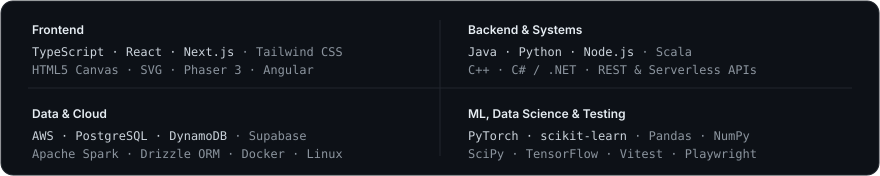

  <picture>
    <source media="(prefers-color-scheme: dark)" srcset="./assets/hero-dark.svg" />
    <source media="(prefers-color-scheme: light)" srcset="./assets/hero-light.svg" />
    
  </picture>

### Projects

<table>
  <tr>
    <td width="50%" valign="top">
      
      <h4>
        <a href="https://github.com/phanturne/stress-alpha">StressAlpha</a>
        &nbsp;·&nbsp;
        <a href="https://stressalpha.vercel.app">Live App ↗</a>
      </h4>
      
Equity earnings and scenario stress-testing web app covering 521 stocks. Combines client-side valuation modeling and custom SVG charts with automated SEC EDGAR &amp; Yahoo Finance ingestion.

      
<code>Next.js</code> · <code>React</code> · <code>TypeScript</code> · <code>Tailwind CSS</code> · <code>PostgreSQL</code> · <code>Drizzle ORM</code>

    </td>
    <td width="50%" valign="top">
      
      <h4>
        <a href="https://github.com/phanturne/pokebastion">PokéBastion TD</a>
        &nbsp;·&nbsp;
        <a href="https://phanturne.github.io/pokebastion/">Play Live ↗</a>
      </h4>
      
Open-map roguelike tower defense game for the browser. Enemies dynamically pathfind around player-built walls across a 28×18 grid, with 152 playable units, specialization trees, and live repositioning.

      
<code>TypeScript</code> · <code>Phaser 3</code> · <code>Vite</code> · <code>HTML5 Canvas</code> · <code>Vitest</code> · <code>Playwright</code>

    </td>
  </tr>
  <tr>
    <td width="50%" valign="top">
      
      
    </td>
    <td width="50%" valign="top">
      
      
    </td>
  </tr>
</table>

### Tech Stack

  <picture>
    <source media="(prefers-color-scheme: dark)" srcset="./assets/stack-dark.svg" />
    <source media="(prefers-color-scheme: light)" srcset="./assets/stack-light.svg" />
    
  </picture>

